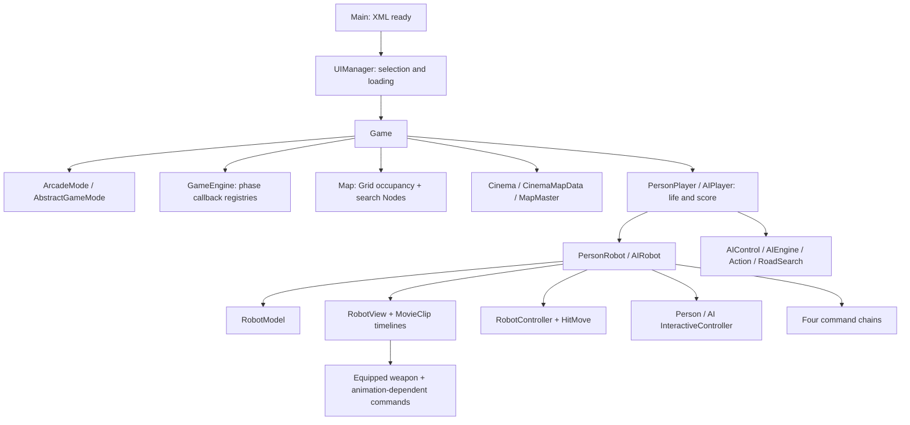

# Edition 5 gameplay structure reconstruction

Static reverse-engineering audit, 2026-10-19. This record reconstructs the **publisher SWF's** Normal Arcade/Cinema execution structure, rather than inferring it from the new Godot game. It supplies a map for a faithful port; it does not claim complete reverse engineering, runtime equivalence, or a newly approved design change.

## Authority and method

Authority is Bomb It 5 v1.6.1, `.scratch/edition-5-research/agame-bomb-it-5-zh-fix.swf`, SHA-256 `718c04c741604bda2bcf4efb19ca3f7cf240b79bc6163f274045c3157e0408a2`. [Provenance and reproducible extraction](edition-5-input-and-timing.md) establish the publisher acquisition and JPEXS 26.3.0 export. This audit inspected that existing decompile directly. ActionScript is reconstructed decompiler output, not recovered author project files.

Unless otherwise stated, locators below are relative to `.scratch/edition-5-research/publisher-scripts/scripts/zlong/bombit5/`. `Main.as` is at the script root. Line numbers refer to this export; class and method names are the durable locators. The embedded XML is `.scratch/edition-5-research/embedded-6787.xml`, matching the [independent data record](edition-5-runtime-data.json).

Two surprising findings were corroborated with a fresh **P-code export from the original SWF**, without modifying it:

```powershell
java -jar .scratch/edition-5-research/ffdec/ffdec.jar -selectclass zlong.bombit5.gameengine.ai.AIControl,zlong.bombit5.gameengine.ai.state.StateAttack -format script:pcode -export script .scratch/edition-5-research/structure-audit-pcode .scratch/edition-5-research/agame-bomb-it-5-zh-fix.swf
```

This command completed successfully. P-code locators use that new ignored export's `scripts/zlong/bombit5/` prefix. No SWF playback, new gameplay video measurement, instrumentation, or physical-device test was performed for this record. Existing supplied captures remain separately assessed in [play observations](edition-5-play-observations.md).

## Construction and ownership



| Step | Recovered path and responsibility | Exact locators |
| --- | --- | --- |
| Bootstrap | `Main.gameStart` initializes cookie/XML; XML completion creates `UIManager` | `Main.as:40–54` |
| Launch selection | UI transitions include settings, character selection and power-ups. `gamePlay` chooses random stage only when requested, sets up saved controls/loading, then constructs `Game` | `ui/UIManager.as:271–324` |
| Mode selection | `Game.init` reads `GameModel.gameMode/difficulty`, chooses `ArcadeMode`, initializes engine/map/display, then initializes mode and map | `gameengine/Game.as:137–172` |
| Mode data | `AbstractGameMode.init` loads lives, clock, permitted pickups and weighted drop setup from XML; Arcade sets the AI attack-target class to `PersonRobot` | `gameengine/gamemode/AbstractGameMode.as:49–86,240–346`; `ArcadeMode.as:22–26` |
| Board construction | `Game.mapInit` creates `MapMaster`, dynamically chooses the stage class and sets difficulty/mode soft-block probability. `Cinema` chooses background/map-data classes; map-data reads named children from the stage editor sprite and pairs portals | `gameengine/Game.as:351–361`; `maps/mapData/Cinema.as:10–17`; `CinemaMapData.as:43–153` |
| Actor construction | After loading, one `PersonPlayer` and the selected AI players create their robots at mode-specific spawn positions. AI profiles are selected by the mode XML | `gameengine/Game.as:364–445,476–491`; `gameengine/gamemode/AbstractGameMode.as:40–46` |
| Start | A 100 ms timeout starts the game, registers clock polling in the periodic tween-callback registry, then starts `ENTER_FRAME` processing | `gameengine/Game.as:476–499,538–541` |

The original board is not just a flattened terrain matrix. `Map` owns both `Grid` cells and separate pathfinding `Node`s. A cell holds different categories of occupants; `isBlock`, `isEmpty`, and `item` are different queries. Pickups, robots and platforms do not collapse into one generic occupied flag. This matters to portals, laser traversal, placement and AI. Locators: `maps/Map.as:44–68,181–247,250–276,304–330,443–471`; `maps/Grid.as:140–181,259–284`.

The recorded fixed Cinema board used by the Godot build remains a deliberate first-build selection. Original `CinemaMapData` chooses artwork variants and supports multiple stage layouts; this audit does not broaden the accepted single-map scope. See [recorded-board reconstruction](cinema-stage1-recorded-board.md).

## Frame execution and mutation

`GameEngine.start/stop` installs/removes `ENTER_FRAME`. The exact top-level order in `enterFrameHandle` is:

| Order | Callback registry | Cadence |
| --- | --- | --- |
| 1 | `_sequenceArr` | At most one rotating callback |
| 2 | `_bombArr` | Enumerate bomb callbacks |
| 3 | `_blastArr` | Enumerate blast cleanup callbacks |
| 4 | `_aiSequenceArr` | At most one rotating AI callback |
| 5 | `_engineArr` | Enumerate general callbacks, including robot engines |
| 6 | `_moveArr` | Call element `[0]` of each registered movement holder |
| 7 | `_tweenArr` | Only when counter equals four; counter resets then increments |
| 8 | `_brickExpArr` | Enumerate block-break animation callbacks |
| 9 | `_deadArr` | Enumerate death animation callbacks |

Locators: `gameengine/GameEngine.as:55–65,230–301`. The periodic counter initially defaults to zero, so its first threshold is reached on the fifth processed frame; following threshold visits are four processed frames apart. This registry is not the whole TweenMax animation system. There is also a wired `Timer(25)` whose startup is not on the recovered active path; it must not be mistaken for the gameplay clock. See the [timing record](edition-5-input-and-timing.md).

The registries are **live arrays**, not snapshots or immutable queues. Registration can append; `Tool.safeRemove`/explicit `splice` removes synchronously, including from callbacks. Sequence indices and lengths are separately maintained. A callback can add work to a later phase in the same frame, while an AI-created ordinary bomb has missed the bomb phase. Human action events can construct a bomb outside this loop before its next bomb phase. Bomb hits synchronously trigger chains and block occupancy mutations. Locators: `GameEngine.as:87–204,272–301`; `gameengine/robot/RobotController.as:141–165`; [bomb phase audit](edition-5-gameplay-phases.md).

**Limit:** the source proves live mutation and phase order, not the exact AVM2 enumeration outcome for every append/remove/reentrant chain. Array mutation cases require runtime traces. A snapshot iteration or deferred-removal queue would be a different policy unless shown equivalent for the selected scenarios.

## Robot state, input and command structure

`AbstractRobot.init` constructs `RobotModel`, `RobotView`, `RobotController`, controller-specific input, command chains, event listeners and spawn invincibility. A robot registers a general-engine callback and a mutable single-function movement holder. `PersonRobot` supplies keyboard input; `AIRobot` supplies synthetic input and additional path-following callbacks. Locators: `gameengine/robot/AbstractRobot.as:84–107,119–126,271–282,454–461`; `PersonRobot.as:14–17`; `AIRobot.as:22–61`.

`RobotModel` owns velocity, current logical cell/state/vehicle, direction memory, bomb counters/arrays, upgrades and equipment references. Its cardinal acceleration methods explicitly zero the other axis; collision/displacement belongs to `RobotController`/`HitMove`, while coordinates and animation are in the view. Consequently MVC names do not imply a pure data-only model or presentation-only view. Locators: `RobotModel.as:96–150`; `RobotController.as:35–44,79–138`; [movement audit](edition-5-movement-and-board.md).

Each robot's general callback runs:

1. `updateRobotPosition()` and depth/container update.
2. `_inEngineArr.execute()` (temporary effects/weapon commands).
3. `_engineArr.execute()`.
4. `_mainEngineArr.execute()` (pickup and map interaction commands).

**Position-change commands are a separate trigger.** `updateRobotPosition` updates map occupancy and invokes `_positionChangeEngine` only when logical x, logical y, state, or vehicle changes. That chain includes `GetFireCommand`. Therefore this source path is not unconditional per-frame fire polling. Since normal movement runs later than robot engines, entry occupancy/fire/pickup observation can occur on the following frame; instantaneous attack damage is a separate path. Locators: `AbstractRobot.as:158–208`; `commands/robot/GetFireCommand.as:33–40`; `GetItemCommand.as:31–48`. Protection expiring while stationary, and state changes while standing in fire, need dedicated runtime traces before adopting a universal continuous-contact rule.

Despite the class name **`CommandChain` is a named-command `Dictionary(true)`**, not an insertion-ordered sequence. Adding uses `command.name` as key; invincibility specially replaces its predecessor. Execution enumerates enabled dictionary values, catches an error and removes the failing command. Removal calls `dispose` immediately. Order within one chain is therefore not established by the order of `addCommand` calls. Locators: `commands/CommandChain.as:21–48,66–100`. This is distinct from the explicit top-level order among the four robot chains.

Keyboard direction presses update a remembered cardinal stack; latest held direction wins. Bomb down/up dispatch immediately to replaceable controller callbacks, with no movement-style held-key deduplication. Equipment installs its own callbacks. `robotMoveStop` saves the movement callback, disables movement listeners and stops the AI brain; `robotMoveStart` restores movement/visuals/listeners and restarts that brain. Pause listeners can update the saved direction. Locators: `gameengine/robot/PersonInteractiveController.as:49–109,130–156`; `InteractiveController.as:21–96`; `RobotController.as:197–279`; `AIInteractiveController.as:113–155`.

## Weapons: animation is executable behavior

Common equipment acquisition replaces the old weapon, updates model/view, installs down/up handlers and constructs ammunition display. Activation stops movement and bomb input, creates direction-specific animation, attaches it in the proper depth order, adds a command to the robot's temporary-effect chain and consumes a use. Held weapon graphics align to the robot's `hand` child and current animation frame. Flamer additionally locates a `gunpoint`. These are gameplay/feedback contracts, not interchangeable decoration. Locators: `items/weapons/AbstractWeapon.as:65–101,112–152,159–208,299–303`; `FlamerProp.as:54–94`.

| Reachable effect | Source sequence and exact locators | What a faithful port must preserve |
| --- | --- | --- |
| Hammer | Half-animation up-facing depth adjustment; hit when `currentFrame >= totalFrames-1`; adjacent terrain/bomb/pickup/platform interaction plus actors in own and adjacent cells; restore control and remove command | `commands/weapon/HammerPlayCommand.as:55–160`. Not merely an adjacent-cell hit at an arbitrary timer |
| Flamer | Each command callback first shoots, then checks inner fire animation at `totalFrames-1` to finish. Endpoint derives from current animated width/height and weapon scale; solid box truncates the fire scale | `commands/weapon/FlamerPlayCommand.as:24–37`; `bombs/FlamerFire.as:36–80`. Recover per-frame bounds and attachment transforms; a linear reach ramp is an approximation |
| Laser | Charge animation threshold creates `Laser`; `ShootLaserCommand` makes one ordered ray hit pass, then replaces itself with `LaserEndCommand`; end counts through `>9` and restores actor/equipment | `commands/weapon/LaserGunPlayCommand.as:39–58`; `LaserPlayCommandChain.as:86–216,240–255`. Visible lifetime differs from damage-pass count; chain mutation can affect first cleanup callback |
| Triple-shot | Emits three projectiles when count modulo15 is zero, starting count0; after third schedules a 0.3-second TweenMax recovery | `commands/weapon/NinjialPlayCommand.as:26–32,50–96`. Preserve sequential shots and separate recovery clock |
| Fireball | Exact final-frame equality creates one `FireballBomb`, then 0.3-second TweenMax recovery | `commands/weapon/ShotGunPlayCommand.as:39–78`. Source class name does not establish a pellet fan; equality should not silently become an unrelated fixed delay |

The [runtime systems record](edition-5-runtime-systems.md) supplies landmine, vehicle, pickup and independently extracted sprite frame counts. Those counts alone cannot supply nested timeline bounds, frame-entry scheduling, attachment locations, or all movement interruption/recovery behavior. Static callbacks prove intentional movement locks; they do not establish rendering-performance lag.

## Normal Arcade AI reconstruction

The selected Arcade Normal XML maps all three AI slots to profile `010201`. It specifies answer time20, range6, model speed1.6/power1/capacity1, ordered actions `0102|0202|0302|0602|0802|1201`, default`0802`. These resolve to **Attack → Evade → GetItem → Box → Free → Escape**, in that order. This is not an inferred "always evade first" priority. Locators: `embedded-6787.xml:242–247,319–330`; `gameengine/ai/AIFactory.as:23–100`; [extracted action attributes](edition-5-runtime-data.json).

`AIFactory` populates control/model/view from XML, resolves permitted item classes, constructs action state objects in that order, and constructs the default state separately. Thus the listed Free state and default Free state are different instances. `AIEngine.update` enters default if necessary; returns immediately while the current action is incomplete; otherwise asks states in order for the first successful transition. It exits/enters on identity change; repeated selection of the same current state increments a counter and resets to default after two repetitions, then updates the selected state. Locators: `AIFactory.as:37–75`; `AIEngine.as:38–90`.

| Layer/state | Directly recovered behavior | Locators |
| --- | --- | --- |
| Perception | Scans within square range; gathers bombs, time-to-explosion, fire, pickups, boxes, targetable actors and safe/free positions; writes danger-related search costs; merges temporary attack danger | `gameengine/ai/AIControl.as:160–396` |
| Attack/Box | Probability gate; choose a weapon-sensitive attack position; ordinary bombs require computed escape availability; move to firing position, then bomb down/up and escape, or turn and use weapon after configured delay | `ai/state/StateAttack.as:30–111,114–141,155–216`; `StateBox.as:30–138`; `AbstractAttackState.as:67–89,162–260,322–457` |
| Evade | Probability gate plus current-cell danger; choose a reachable free position and route there | `ai/state/StateEvade.as:16–51` |
| GetItem | Probability gate; randomized item candidates with path cost `<100`; route until arrival/cancellation | `ai/state/StateGetItem.as:16–75` |
| Free | Probability gate, refreshed perception, randomized reachable destination selection; per-step dodge/attack opportunities | `ai/state/StateFree.as:18–73`; `AbstractState.as:109–216` |
| Escape | Current danger or an invincible actor can qualify; filters positions within Manhattan distance4 of such actors; route cancellation reevaluates threats | `ai/state/StateEscape.as:49–101,106–201` |
| Action execution | Route following continues in `AIRobot.robotEngine` every frame, separate from rotating brains; synthetic key events select cardinal movement. Directional grid checks include five-source-unit margins; lack of progress for more than ten orientation callbacks cancels | `robot/AIRobot.as:34–97`; `ai/Action.as:61–204` |
| Search | A custom four-neighbor search with platform direction constraints and cost multipliers; estimated-price ranking and returned cost sum are source-specific | `ai/astar/RoadSearch.as:76–215`. Replacing it with unweighted BFS changes priorities even when routes remain legal |

Paths in the table abbreviate `gameengine/` after the first row. `AbstractState` uses a real `Timer(2000)` for action cancellation; on-step dodge and attack share one random draw. Attack weapon delay is `setTimeout`, and escape recovery may use TweenMax. These systems are not all measured in AI brain callbacks or logical ticks. Locators: `AbstractState.as:52–78,109–145`; `AbstractAttackState.as:322–350,419–438`.

### Newly corroborated source quirks

- **Answer time is not a recurring throttle as written.** `AIControl.update` compares cached `_time` to `aiAnswerTime`. Once greater, it updates perception/state and `_lastTime`, but does not reset `_time`; subsequent opportunities remain in that branch. Fresh P-code corroborates the missing reset: `gameengine/ai/AIControl.pcode:374–427`, especially400–421. It does not prove measured responsiveness or intended author behavior. Porting a recurring20ms delay would change this source behavior.
- **Danger construction is asymmetric as exported.** Four ray-continuation booleans are initialized before the full scan, not per bomb, and the upward-ray danger entry additionally requires remaining time`<30`. Locators: `AIControl.as:189–192,217–291`. These should be traced before "cleaning up" the algorithm or claiming uniform threat handling.
- **Unrelated data really is in the SWF.** `StateAttack.escapeRouteAnalysis` computes its escape candidates, then constructs an otherwise-unused252-object localization array for another title. Fresh P-code shows the computation followed by the array construction/store/return (`ai/state/StateAttack.pcode:493–1258`), matching decompile142–152. This rules out mere local `.as` contamination for that fragment. Its purpose and performance cost are unmeasured; it is not edition5 gameplay data to recreate. Preserving gameplay structure does not require reproducing unrelated unused allocations.

Stopping or killing an AI removes its brain handler, changing the rotating active population. Normal movement interruption does this through `RobotController.robotMoveStop`; death also does it through `AIPlayer.robotDead`. Locators: `robot/RobotController.as:225–242`; `gameengine/AIPlayer.as:28–44`; `AIControl.as:123–130`. Fixed dead-slot rotation differs from this lifecycle.

## Damage, death and results are separate stages

`TryToKillCommandChain` guards existence/dead state, handles vehicle loss first, then shield, then lethal death. Vehicle damage has a one-second animation tween and later protection/control restoration. `RobotDeadCommand.execute` invokes player death immediately and registers a dead-animation callback. Robot death removes active robot/movement/engine registration; only when the death animation reaches its penultimate-frame threshold does the callback call `Game.deleRobot`, which invokes the mode ending check. Thus actor removal and results are not the same instant. Locators: `commands/robot/TryToKillCommandChain.as:34–77`; `RobotDeadCommand.as:32–58`; `gameengine/robot/AbstractRobot.as:233–241,278–282`; `gameengine/Game.as:825–828`.

Arcade deletes the dead player's robot, then counts surviving human/AI robots, checking human absence before AI absence. Win/loss stops the game and plays an ending cartoon; its completion computes score and opens results. Loss handling decrements personal-player retry lives before restart/game-over selection. Locators: `gameengine/gamemode/ArcadeMode.as:106–163`; `AbstractGameMode.as:95–182`. A life pickup/player retry-life setter must not be conflated with a separate generic actor hitpoint system.

Clock polling uses `Date().getSeconds()` in the periodic callback, incrementing elapsed time once whenever the observed seconds field differs. Timeout disposes the engine and invokes mode timeout; one-human Arcade timeout eventually calls win regardless of remaining enemies in this recovered path. Locators: `gameengine/Game.as:796–816`; `ArcadeMode.as:43–85`. The accepted simulation clock and timeout-loss rule deliberately replace this; this audit does not propose reverting them.

## Faithful-port implications and open verification

Preserve the original's meaningful seams: session/player versus robot, logical cell queries versus physical collision, per-frame phases versus immediate input, equipment commands versus timelines, AI state selection versus route following, and death versus results. Do not treat matching class names, frame totals or passing Godot-only tests as proof of parity.

Before a replacement is called faithful, trace matching controlled scenarios in the untouched reference or an explicitly identified instrumented copy: input before/after bomb phase; callback addition/removal and simultaneous chains; first/final lethal fire entry; stationary protection expiry in fire; attack frames/bounds and control restoration in all directions; death/result delay; AI state transitions, RNG draws and active-handler rotation. Keep instrumentation changes and emulator limitations identifiable. Reconcile those observations with static findings rather than treating either as universal proof.

Existing accepted adaptations remain authoritative: admitted command batches and event ownership,35Hz bounded external scheduling, simulation clock, timeout loss, focus/pause reset, eight-direction movement, overlap departure and fixed recorded first board. Their differences need an explicit conversion map when porting original internals. The four unresolved named item slots and production exclusion of copied SWF assets remain unchanged. This report does not import edition1 code/assets, expand modes/maps, change joystick staging or authorize shipping reference art.

Current implementation and validation status remain in [development](../development.md). This record is primary-source structure evidence, not a claim that those structures have already replaced the simplified Godot implementation.
