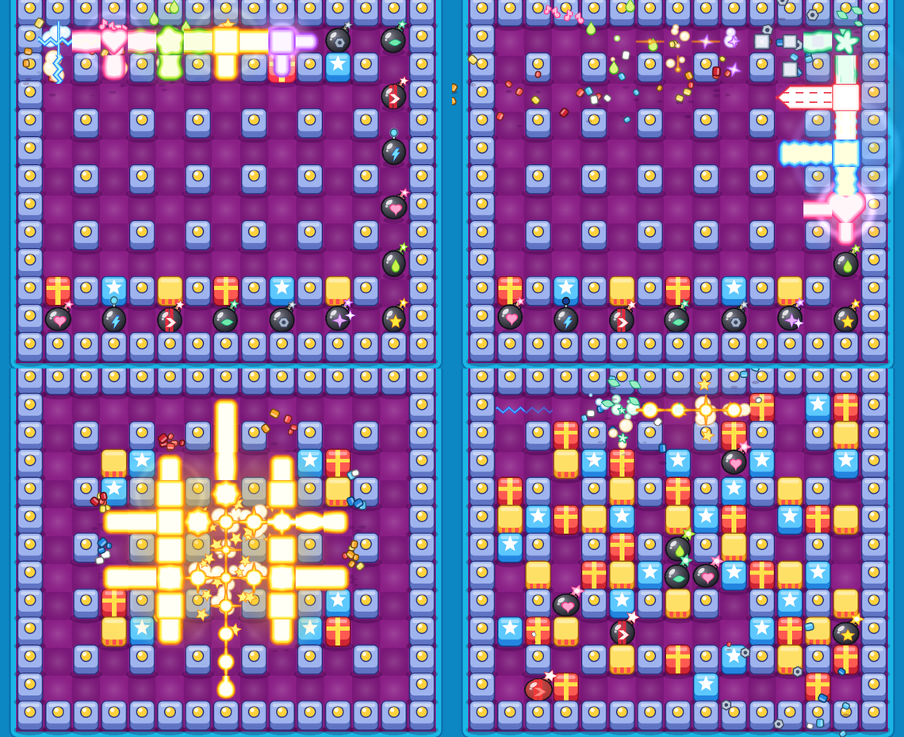
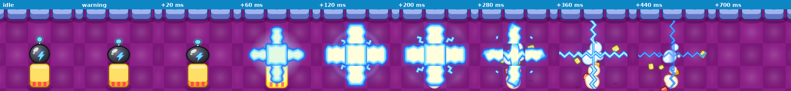
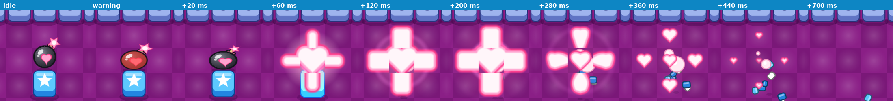
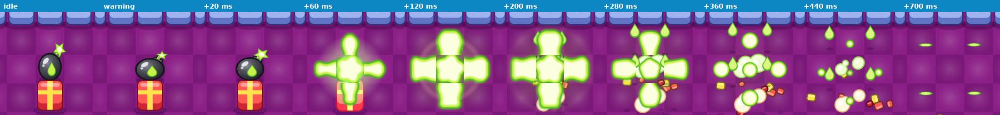
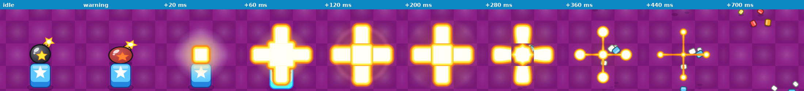
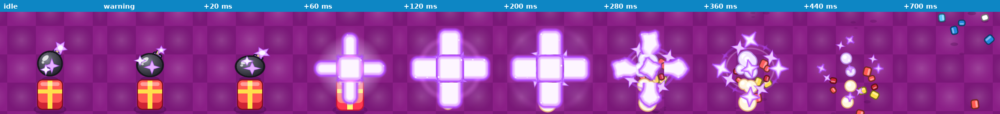
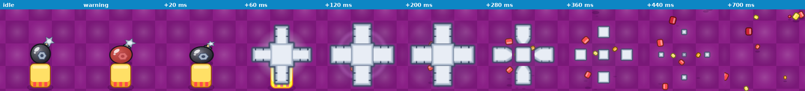
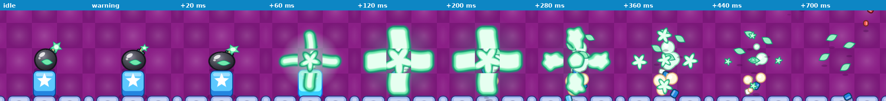
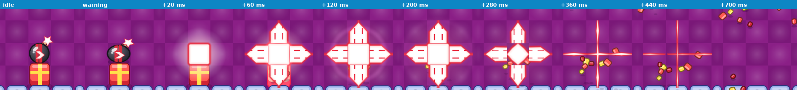

# Explosion lab

An experiment, not part of any checkpoint and not shipped. It explores how far 2D bomb
explosions can be pushed toward "juicy", including fake-3D tricks, inside this project's
constraints: Godot 4.5, **Compatibility renderer** (needed for the Douyin/web export),
and gameplay owned by `scripts/simulation/`.



## Fidelity note

The faithful replica must take its explosion art and timing from the SWF (AGENTS.md:
generate, don't invent). None of these effects belong in the replica profile. They are
candidates for the new-art (Douyin) build profile, and the owner decides whether any of
them ship. All art here is procedural placeholder; no original art is used.

## Art style

The first version looked realistic and grim (noise fire, dimmed board, cast shadows,
grey smoke, scorch marks), which is not how Bomb It looks. The style now follows
captures of the original in `docs/evidence/reference-2026-10-19/`
(`cinema-base-01/explosion.png`, `cinema-base-01/bomb.png`,
`chains/overlap-left-first/both-visible.png`, `chains/*/after-chain.png`):

- **Board:** saturated floor with a soft light spot per cell, inside a glossy cyan
  frame. Nothing is dimmed, lit or shadowed.
- **Blocks:** chunky, glossy, candy-coloured, outlined in a darker shade of their own
  hue, and taller than a cell so they overlap the row above (one y-sorted layer).
- **Bomb:** a big glossy dark ball with a cap, a short fuse and a cartoon spark.
- **Blast:** a flat gradient, white-hot block to yellow to a soft orange rim, with no
  noise. It pops in with an overshoot, then each cell shrinks to a glowing ball with
  pointed streaks along the ray, as the original's blast does when it ends.
- **Around it:** cream puffs instead of smoke, stars instead of embers, outlined chunks
  in the block's own colours, and blocks and bombs that bounce like rubber toys.

The shapes and motifs are the lab's own; only the style is taken from the captures.

## Bomb profiles

The original gives every robot the same bomb and blast. As a new-art idea, each of the
eight robots gets its own, built from that robot's character as the original draws it
(HUD portraits in `docs/evidence/reference-2026-10-21/{green-zone,pac-man,kill}`, whose
`summary.json` files give each seat's robot index).

**The danger contract.** The lab started from one rule: effects are presentation only,
and a player must always read where and when a blast hurts. So every bomb keeps:

- the same footprint: exactly the simulation's blast cells, one cross per blast;
- the same timing: 16 ticks per cell, chain stagger and passing-flame order from
  `ChainOrder.starts`;
- a full-width cell with a white-hot core while the cell is live, then a small "spent"
  shape (morph at age 0.42–0.68 of the cell's life), gone at age 1;
- the same last warning: the final 8 fuse ticks squash the bomb and blink it red;
- a calm screen: one signature burst of four pieces per blast, capped at 20 on screen.

Personality goes only into five beats: how the bomb waits, how the blast pops, how its
edge moves, what it shrinks to, and its signature burst. Code: `bomb_styles.gd` (table),
`bomb_view.gd` (wait), `flame.gdshader` (pop, edge, centre, spent shape), `toon_fx.gd`
(signature burst), `lab.gd` `_burst` (shockwave and shake).

| Robot | Character | Theme | Bomb waits | Pop and edge | Spent shape | Signature burst |
| --- | --- | --- | --- | --- | --- | --- |
| Blue | little blue bot, antenna, headphones; the hero | Circuit Zap | antenna LED blinks faster | crisp box; edge crackles in a zigzag, core buzzes | thin bolt that keeps crackling | four sparks zip out on the diagonals |
| Ruby | pink pop idol, pigtails, headphones | Encore | hops to the beat | heart-shaped centre; arms throb like a speaker; shockwave comes twice | little upright hearts | four music notes float up |
| Lime | green alien, horn, sunglasses | Alien Goo | wobbles like jelly | wobbly blob; goo wave runs out along the arms | blobs that sag toward the floor | four drops arc out and splat flat |
| Gold | orange tough guy, helmet (viking horns in play) | Big Kaboom (the original's colours) | plain pulse, a little stronger | biggest overshoot, heaviest shake | the original's ball with streaks | four stars |
| Violet | purple sailor girl (witch's hat in play) | Spellburst | floats, a twinkle orbits it | twinkle-shaped centre; glitter twinkles on the band | small twinkles | spell ring plus four twinkles spiralling out |
| Slate | grey bot, black pompadour | Heavy Metal | rattles harder as it burns | hard square, little give; riveted plates, dead-straight edges | small hard squares | four nuts thrown up, clattering twice |
| Mint | gentle girl, long green twin tails | Bloom | rocks gently | flower centre unfurls softly; arms sway; no shockwave, lightest shake | small flowers | four leaves drift down, rocking |
| Snow | white racing helmet, red stripes | Turbo | revs with a fine shiver | instant pop, arrow-nosed tips, red dashes stream down the arms | speed lines sliding outward | four speed lines shoot on past the tips |

Profile sheets: the bomb idle, its warning, then its blast at fixed times after it
shows. They are captured from the lab, not drawn.

| | |
| --- | --- |
| Blue |  |
| Ruby |  |
| Lime |  |
| Gold |  |
| Violet |  |
| Slate |  |
| Mint |  |
| Snow |  |

Regenerate them (the sheet capture sets one bomb per robot and records each bomb's
screen position and blast time in `layout.json`):

```bash
xvfb-run -a godot --path . --rendering-driver opengl3 --resolution 1920x1080 --fixed-fps 60 \
  res://experiments/explosion_lab/lab.tscn -- --capture=.scratch/sheet --sheet --off=shake
```

```bash
python3 experiments/explosion_lab/make_sheets.py .scratch/sheet experiments/explosion_lab/media/bombs
```

`T` picks the robot whose bombs a click places; `O` sets one bomb per robot side by
side. The chain and random presets mix robots.

## Run

```bash
godot --path . res://experiments/explosion_lab/lab.tscn
```

| Input | Action |
| --- | --- |
| Left click / right click | Place a bomb / toggle a crate |
| Wheel, `[` `]` | Bomb power |
| `C` `V` `G` `O` `R` | Presets: chain snake, dense cluster, random play, one bomb per robot, reset |
| `T` | Next robot for placed bombs |
| Space | Detonate every bomb next tick |
| `1`–`9`, `S`, `H`, `B` | Toggle layers (see the HUD): anticipation, stagger, core, glow, bounce, shockwave, smoke (puffs), sparkles, debris, shake, hit-stop, hitbox overlay |
| `-` `=` / `,` `.` | Chain step / ring step (ms) |
| `P` / `F` | Quarter-speed slow motion / shockwave style (light ring or refraction) |

Headless capture, used to review the effects here (llvmpipe under xvfb):

```bash
xvfb-run -a godot --path . --rendering-driver opengl3 --resolution 1280x720 --fixed-fps 60 \
  res://experiments/explosion_lab/lab.tscn -- --capture=.scratch/fx --preset=chain --off=shake
```

Ordering check (not in `tools/run_checks.sh`):

```bash
godot --headless --path . --script res://experiments/explosion_lab/lab_check.gd
```

## How it is built

**Logic and visuals are split at the simulation boundary.** The lab drives the real
`BombSimulation` (`add_bomb`, `advance`) with damage off and reads only `blasts` and
`broken_soft_blocks`. `_detonate`, the port of `Bomb.blast`, grows rays ring by ring and
detonates a reached bomb inline, so **a whole chain resolves in one 35 Hz tick**. The
lab never delays a hit. It only decides when each cell appears on screen:

```text
visual delay = chain depth x chain_step (70 ms) + ring distance x ring_step (22 ms)
```

The simulation also lets a later ray run through a cell whose bomb an earlier branch of
the chain already set off. On screen that bomb goes off when the flame reaches it
(`ChainOrder.starts`), so a flame never crosses a bomb that still looks unexploded.

`chain_order.gd` recovers chain depth from the blast geometry: the cell just past a
ray's last flame is where the chained bomb sat. A bomb's own sprite stays until its
flame shows, so chained bombs don't vanish early. The `B` overlay draws the true hit
cells at simulation time, so the visual lag can be judged directly. A 10-bomb chain
trails the hitbox by about 0.7 s; whether that reads well in play is for the owner to
judge.

**Layers, back to front**

| Layer | Technique | Where |
| --- | --- | --- |
| Floor and frame | Flat colours plus a soft radial spot per cell | `lab.gd` `_draw_floor` |
| Blocks and bombs | Drawn by hand (rounded boxes, circles, outlines) on one y-sorted layer; no textures, lights or normal maps | `block_view.gd`, `bomb_view.gd` |
| Debris | Custom outlined chunks with ground position plus height, and a shadow that shrinks with height (2.5D) | `debris.gd` |
| Flash and glow | Alpha-blended radial sprites: 0.12 s white flash, 0.4 s yellow swell | `_flash` |
| Flame | One shader on per-cell quads, one material per robot: signed-distance shapes (block, band, tip, then the robot's spent shape). Each cell is drawn as three colour layers (rim, band, core) on rising z, so overlapping cells and crossing blasts merge into one shape; toggle `core` drops the white layer | `flame.gdshader`, `_add_flame` |
| Joined chains | A ray's tip facing another burning cell opens into a plain arm once that cell shows | `_link_tips` |
| Puffs and signature bursts | Hand-drawn and outlined, under the flames. Each blast throws four pieces of its robot's signature, each moving its own way (see Bomb profiles); totals are capped (20 pieces, 30 puffs) so a chain stays tidy | `toon_fx.gd` |
| Bounce | Blocks and bombs within reach squash and spring back, nearest first | `_bounce_around` |
| Shockwave | Additive light ring (default) or screen-texture refraction (`F`) | `shockwave_*.gdshader` |
| Camera | Trauma-squared noise shake (kept small); hit-stop of 35–120 ms scaled by batch size | `_update_shake`, `_start_hitstop` |

Per-cell flame parameters (age, kind, seed) are packed into `modulate`, so every flame
quad shares one material and the batch stays cheap. Bomb anticipation reads the
simulation's own `age` and `fuse`. The pulse speeds up as the fuse burns, and the last
8 ticks squash the bomb and blink it red.

**Gameplay never pauses.** The simulation steps on real time, while hit-stop and slow
motion scale only `Engine.time_scale`, which drives tweens, particles and the effects
clock.

## Findings

- **Compatibility renderer:** 2D HDR is documented for Forward+ and Mobile only, so
  there is no bloom; the flat cartoon look does not need it. GPUParticles2D has
  reported load and first-use stutter on web exports; the lab now uses no particle
  nodes at all (puffs, stars and chunks are drawn by hand).
- **No 2D MSAA:** Godot 4.5 reports "2D MSAA is not yet supported for GLES3", so
  shapes bring their own smoothing: circles and rounded boxes use the built-in
  antialiasing, polygons (stars) get a one-pixel feathered edge line (`toon_draw.gd`).
- **Screen-texture refraction:** under Compatibility on llvmpipe, the copied screen
  came back brighter than the screen, showing as a pale disc, and a `pow(2.2)` fix
  overshot. Refraction stays opt-in (`F`) until it is checked on a phone GPU.
- **Realistic lighting fights the style:** the first version dimmed the board and lit
  it with shadowed 2D lights and normal maps. It read as a different, grimmer game, so
  all of it is gone.
- **Simulation quirk worth knowing:** two bombs due on the same tick go off on
  consecutive ticks. `_detonate` erases from `_countdowns` mid-pass, which skips the
  next entry. The comment there ("live registry removal") suggests this is
  deliberate; no change was made.
- **Flame quads need headroom:** arms are 1.02 x 1.45 cells and the centre quad is 1.45
  cells, so the soft rim never reaches the quad border.

## Sources

- Godot docs, list of features (2D HDR on Forward+/Mobile):
  <https://docs.godotengine.org/en/4.4/about/list_of_features.html>
- GPUParticles2D web load delay: <https://github.com/godotengine/godot/issues/87843>
- First-use particle shader stutter on web:
  <https://forum.godotengine.org/t/handling-particle-shader-compilation-lag-in-godot-4-web-compatibility-renderer/36170>
- Hit-stop and trauma shake ranges:
  <https://forum.godotengine.org/t/tutorial-hit-stop-and-screen-shake-in-godot-4-autoload-trauma-camera-mit/145240>

## Next ideas

- Audio sync: fire `bomb` once per chain step rather than once per tick, to match the
  visual stagger.
- Decide with the owner whether chain stagger belongs in the new-art profile at all.
