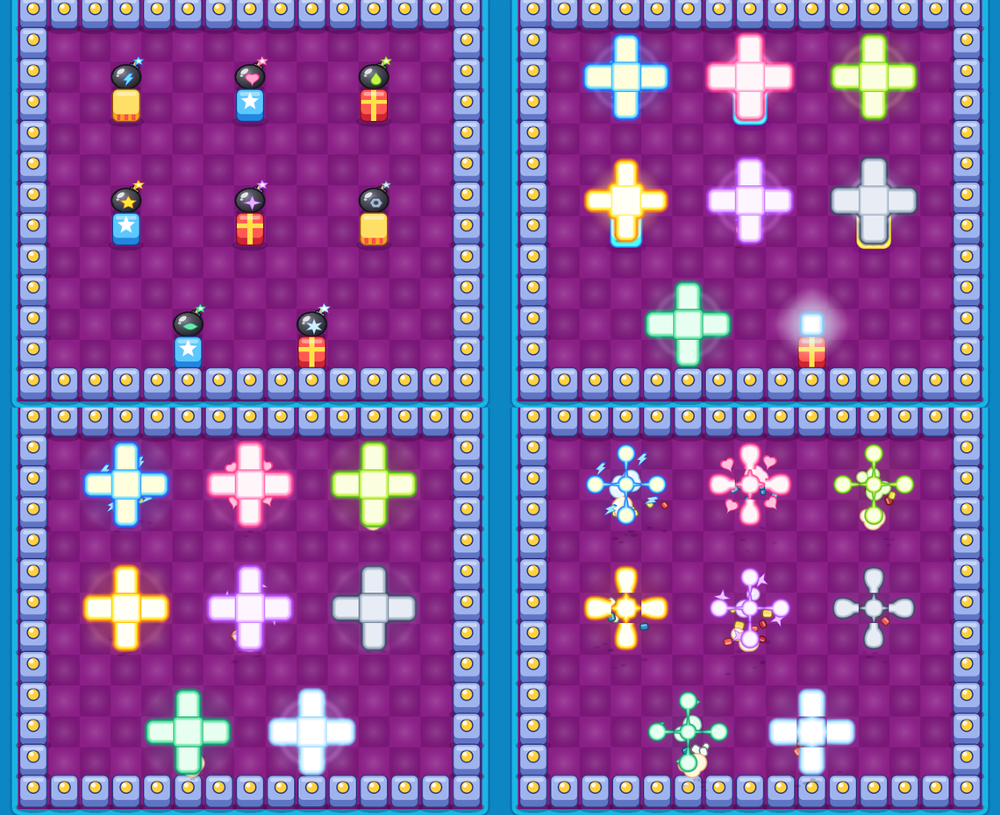

# Explosion lab

An experiment, not part of any checkpoint and not shipped. It explores how far 2D bomb
explosions can be pushed toward "juicy", including fake-3D tricks, inside this project's
constraints: Godot 4.5, **Compatibility renderer** (needed for the Douyin/web export),
and gameplay owned by `scripts/simulation/`.


## Fidelity note

The faithful replica must take its explosion art and timing from the SWF (AGENTS.md:
generate, don't invent). None of these effects belong in the replica profile. They are
candidates for the new-art (Douyin) build profile, and the owner decides whether any of
them ship. All art here is procedural placeholder; no original art is used.

## Art style

The first version looked realistic and grim (noise fire, dimmed board, cast shadows,
grey smoke, scorch marks), which is not how Bomb It looks. The style now follows
captures of the original in `docs/evidence/reference-2026-10-19/`
(`cinema-base-01/explosion.png`, `cinema-base-01/bomb.png`,
`chains/overlap-left-first/both-visible.png`, `chains/*/after-chain.png`):

- **Board:** saturated floor with a soft light spot per cell, inside a glossy cyan
  frame. Nothing is dimmed, lit or shadowed.
- **Blocks:** chunky, glossy, candy-coloured, outlined in a darker shade of their own
  hue, and taller than a cell so they overlap the row above (one y-sorted layer).
- **Bomb:** a big glossy dark ball with a cap, a short fuse and a cartoon spark.
- **Blast:** a flat gradient, white-hot block to yellow to a soft orange rim, with no
  noise. It pops in with an overshoot, then each cell shrinks to a glowing ball with
  pointed streaks along the ray, as the original's blast does when it ends.
- **Around it:** cream puffs instead of smoke, stars instead of embers, outlined chunks
  in the block's own colours, and blocks and bombs that bounce like rubber toys.

The shapes and motifs are the lab's own; only the style is taken from the captures.

## One bomb effect per robot

The original gives every robot the same bomb and blast. As a new-art idea, each of the
eight robots gets its own (`bomb_styles.gd`, in `Session.ROBOTS` order). Every style
keeps the original's form, the glossy dark ball and the flat three-band cross, and
changes only the colours, the shape that bursts out, and the emblem on the bomb.



| Robot | Theme | Blast colours | Burst shape and emblem |
| --- | --- | --- | --- |
| Blue | Spark | pale yellow, cyan, blue | lightning bolt |
| Ruby | Sweetheart | white, pink, hot pink | heart |
| Lime | Slime | pale lime, lime, green | drop |
| Gold | Sunburst (the original's own colours) | white, yellow, orange | five-point star |
| Violet | Magic | white, lilac, purple | four-point twinkle |
| Slate | Steel | pale steel, grey, dark slate | hex nut |
| Mint | Leaf | pale mint, mint, teal | leaf |
| Snow | Frost | white, ice, sky blue | snowflake |

`T` picks the robot whose bombs a click places; `O` sets one bomb per robot side by
side. The chain and random presets mix robots.

## Run

```bash
godot --path . res://experiments/explosion_lab/lab.tscn
```

| Input | Action |
| --- | --- |
| Left click / right click | Place a bomb / toggle a crate |
| Wheel, `[` `]` | Bomb power |
| `C` `V` `G` `O` `R` | Presets: chain snake, dense cluster, random play, one bomb per robot, reset |
| `T` | Next robot for placed bombs |
| Space | Detonate every bomb next tick |
| `1`–`9`, `S`, `H`, `B` | Toggle layers (see the HUD): anticipation, stagger, core, glow, bounce, shockwave, smoke (puffs), sparkles, debris, shake, hit-stop, hitbox overlay |
| `-` `=` / `,` `.` | Chain step / ring step (ms) |
| `P` / `F` | Quarter-speed slow motion / shockwave style (light ring or refraction) |

Headless capture, used to review the effects here (llvmpipe under xvfb):

```bash
xvfb-run -a godot --path . --rendering-driver opengl3 --resolution 1280x720 --fixed-fps 60 \
  res://experiments/explosion_lab/lab.tscn -- --capture=.scratch/fx --preset=chain --off=shake
```

Ordering check (not in `tools/run_checks.sh`):

```bash
godot --headless --path . --script res://experiments/explosion_lab/lab_check.gd
```

## How it is built

**Logic and visuals are split at the simulation boundary.** The lab drives the real
`BombSimulation` (`add_bomb`, `advance`) with damage off and reads only `blasts` and
`broken_soft_blocks`. `_detonate`, the port of `Bomb.blast`, grows rays ring by ring and
detonates a reached bomb inline, so **a whole chain resolves in one 35 Hz tick**. The
lab never delays a hit. It only decides when each cell appears on screen:

```text
visual delay = chain depth x chain_step (70 ms) + ring distance x ring_step (22 ms)
```

The simulation also lets a later ray run through a cell whose bomb an earlier branch of
the chain already set off. On screen that bomb goes off when the flame reaches it
(`ChainOrder.starts`), so a flame never crosses a bomb that still looks unexploded.

`chain_order.gd` recovers chain depth from the blast geometry: the cell just past a
ray's last flame is where the chained bomb sat. A bomb's own sprite stays until its
flame shows, so chained bombs don't vanish early. The `B` overlay draws the true hit
cells at simulation time, so the visual lag can be judged directly. A 10-bomb chain
trails the hitbox by about 0.7 s; whether that reads well in play is for the owner to
judge.

**Layers, back to front**

| Layer | Technique | Where |
| --- | --- | --- |
| Floor and frame | Flat colours plus a soft radial spot per cell | `lab.gd` `_draw_floor` |
| Blocks and bombs | Drawn by hand (rounded boxes, circles, outlines) on one y-sorted layer; no textures, lights or normal maps | `block_view.gd`, `bomb_view.gd` |
| Debris | Custom outlined chunks with ground position plus height, and a shadow that shrinks with height (2.5D) | `debris.gd` |
| Flash and glow | Alpha-blended radial sprites: 0.12 s white flash, 0.4 s yellow swell | `_flash` |
| Flame | One shared shader on per-cell quads: signed-distance shapes (block, band, rounded tip, then ball with streaks). Each cell is drawn as three colour layers (rim, band, core) on rising z, so overlapping cells and crossing blasts merge into one shape; toggle `core` drops the white layer | `flame.gdshader`, `_add_flame` |
| Joined chains | A ray's tip facing another burning cell opens into a plain arm once that cell shows | `_link_tips` |
| Puffs and sparkles | Hand-drawn and outlined, under the flames. Each blast throws one ring of four of its robot's shape, which fly out, slow and shrink; totals are capped (20 shapes, 30 puffs) so a chain stays tidy | `toon_fx.gd` |
| Bounce | Blocks and bombs within reach squash and spring back, nearest first | `_bounce_around` |
| Shockwave | Additive light ring (default) or screen-texture refraction (`F`) | `shockwave_*.gdshader` |
| Camera | Trauma-squared noise shake (kept small); hit-stop of 35–120 ms scaled by batch size | `_update_shake`, `_start_hitstop` |

Per-cell flame parameters (age, kind, seed) are packed into `modulate`, so every flame
quad shares one material and the batch stays cheap. Bomb anticipation reads the
simulation's own `age` and `fuse`. The pulse speeds up as the fuse burns, and the last
8 ticks squash the bomb and blink it red.

**Gameplay never pauses.** The simulation steps on real time, while hit-stop and slow
motion scale only `Engine.time_scale`, which drives tweens, particles and the effects
clock.

## Findings

- **Compatibility renderer:** 2D HDR is documented for Forward+ and Mobile only, so
  there is no bloom; the flat cartoon look does not need it. GPUParticles2D has
  reported load and first-use stutter on web exports; the lab now uses no particle
  nodes at all (puffs, stars and chunks are drawn by hand).
- **No 2D MSAA:** Godot 4.5 reports "2D MSAA is not yet supported for GLES3", so
  shapes bring their own smoothing: circles and rounded boxes use the built-in
  antialiasing, polygons (stars) get a one-pixel feathered edge line (`toon_draw.gd`).
- **Screen-texture refraction:** under Compatibility on llvmpipe, the copied screen
  came back brighter than the screen, showing as a pale disc, and a `pow(2.2)` fix
  overshot. Refraction stays opt-in (`F`) until it is checked on a phone GPU.
- **Realistic lighting fights the style:** the first version dimmed the board and lit
  it with shadowed 2D lights and normal maps. It read as a different, grimmer game, so
  all of it is gone.
- **Simulation quirk worth knowing:** two bombs due on the same tick go off on
  consecutive ticks. `_detonate` erases from `_countdowns` mid-pass, which skips the
  next entry. The comment there ("live registry removal") suggests this is
  deliberate; no change was made.
- **Flame quads need headroom:** arms are 1.02 x 1.45 cells and the centre quad is 1.45
  cells, so the soft rim never reaches the quad border.

## Sources

- Godot docs, list of features (2D HDR on Forward+/Mobile):
  <https://docs.godotengine.org/en/4.4/about/list_of_features.html>
- GPUParticles2D web load delay: <https://github.com/godotengine/godot/issues/87843>
- First-use particle shader stutter on web:
  <https://forum.godotengine.org/t/handling-particle-shader-compilation-lag-in-godot-4-web-compatibility-renderer/36170>
- Hit-stop and trauma shake ranges:
  <https://forum.godotengine.org/t/tutorial-hit-stop-and-screen-shake-in-godot-4-autoload-trauma-camera-mit/145240>

## Next ideas

- Audio sync: fire `bomb` once per chain step rather than once per tick, to match the
  visual stagger.
- Decide with the owner whether chain stagger belongs in the new-art profile at all.
