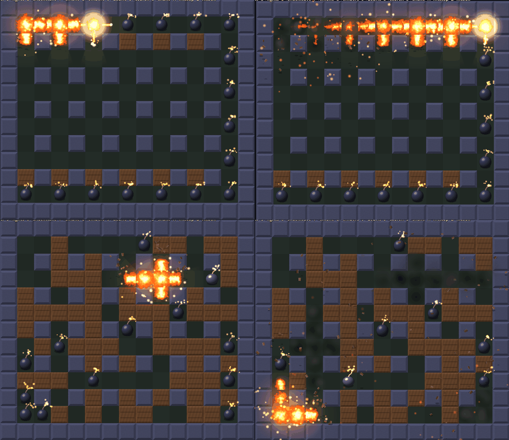

# Explosion lab

An experiment, not part of any checkpoint and not shipped. It explores how far 2D bomb
explosions can be pushed toward "juicy", including fake-3D tricks, inside this project's
constraints: Godot 4.5, **Compatibility renderer** (needed for the Douyin/web export),
and gameplay owned by `scripts/simulation/`.



## Fidelity note

The faithful replica must take its explosion art and timing from the SWF (AGENTS.md:
generate, don't invent). None of these effects belong in the replica profile. They are
candidates for the new-art (Douyin) build profile, and the owner decides whether any of
them ship. All art here is procedural placeholder; no original art is used.

## Run

```bash
godot --path . res://experiments/explosion_lab/lab.tscn
```

| Input | Action |
| --- | --- |
| Left click / right click | Place a bomb / toggle a crate |
| Wheel, `[` `]` | Bomb power |
| `C` `V` `G` `R` | Presets: chain snake, dense cluster, random play, reset |
| Space | Detonate every bomb next tick |
| `1`–`0`, `S`, `H`, `B` | Toggle layers (see the HUD): anticipation, stagger, core, glow, lights, shockwave, smoke, embers, debris, scorch, shake, hit-stop, hitbox overlay |
| `-` `=` / `,` `.` | Chain step / ring step (ms) |
| `P` / `F` | Quarter-speed slow motion / shockwave style (light ring or refraction) |

Headless capture, used to review the effects here (llvmpipe under xvfb):

```bash
xvfb-run -a godot --path . --rendering-driver opengl3 --resolution 1280x720 --fixed-fps 60 \
  res://experiments/explosion_lab/lab.tscn -- --capture=.scratch/fx --preset=chain --off=shake
```

Ordering check (not in `tools/run_checks.sh`):

```bash
godot --headless --path . --script res://experiments/explosion_lab/lab_check.gd
```

## How it is built

**Logic and visuals are split at the simulation boundary.** The lab drives the real
`BombSimulation` (`add_bomb`, `advance`) with damage off and reads only `blasts` and
`broken_soft_blocks`. `_detonate`, the port of `Bomb.blast`, grows rays ring by ring and
detonates a reached bomb inline, so **a whole chain resolves in one 35 Hz tick**. The
lab never delays a hit. It only decides when each cell appears on screen:

```text
visual delay = chain depth x chain_step (70 ms) + ring distance x ring_step (22 ms)
```

`chain_order.gd` recovers chain depth from the blast geometry: the cell just past a
ray's last flame is where the chained bomb sat. A bomb's own sprite stays until its
flame shows, so chained bombs don't vanish early. The `B` overlay draws the true hit
cells at simulation time, so the visual lag can be judged directly. A 10-bomb chain
trails the hitbox by about 0.7 s; whether that reads well in play is for the owner to
judge.

**Layers, back to front**

| Layer | Technique | Where |
| --- | --- | --- |
| Floor, scorch, blocks, bombs, debris | Board canvas, dimmed by `CanvasModulate` so lights pop | `lab.gd` |
| Block and bomb depth | Procedural bevel/sphere **normal maps** (`CanvasTexture`) lit by an unshadowed `PointLight2D` | `fx_textures.gd` |
| Cast shadows | A second, shadowed `PointLight2D` lights the floor only; every block has a `LightOccluder2D` | `_make_light_pair` |
| Smoke | `CPUParticles2D`, normal blend, emitted along the whole cross, rises and swells | `_smoke` |
| Flame body | One shared shader on per-cell quads: world-space scrolling noise, heat ramp, cylinder "volume" shading and a hot rim | `fire_body.gdshader` |
| Flame core | Same field, half width, **additive**: fake HDR without HDR 2D | `fire_core.gdshader` |
| Flash and glow | Additive radial sprites: 0.1 s white flash, 0.45 s orange swell | `_flash` |
| Embers | Additive `CPUParticles2D` launched up against strong gravity: sparks arc and fall (fake z) | `_embers` |
| Debris | Custom chunks with ground position plus height, and a shadow that shrinks with height (2.5D) | `debris.gd` |
| Shockwave | Additive light ring (default) or screen-texture refraction (`F`) | `shockwave_*.gdshader` |
| Camera | Trauma-squared noise shake; hit-stop of 35–120 ms scaled by batch size | `_update_shake`, `_start_hitstop` |

Per-cell flame parameters (age, kind, seed) are packed into `modulate`, so every flame
quad shares two materials and the batch stays cheap. Bomb anticipation reads the
simulation's own `age` and `fuse`. The pulse speeds up as the fuse burns, and the last
8 ticks squash and whiten the bomb.

**Gameplay never pauses.** The simulation steps on real time, while hit-stop and slow
motion scale only `Engine.time_scale`, which drives tweens, particles and the effects
clock.

## Findings

- **Compatibility renderer:** 2D HDR is documented for Forward+ and Mobile only, so
  bloom is faked with additive layers. GPUParticles2D has reported load and first-use
  stutter on web exports, so the lab uses CPUParticles2D throughout.
- **Screen-texture refraction:** under Compatibility on llvmpipe, the copied screen
  came back brighter than the screen, showing as a pale disc, and a `pow(2.2)` fix
  overshot. Refraction stays opt-in (`F`) until it is checked on a phone GPU.
- **Light strength:** an unshadowed light at energy 1.6 washed the stone blocks out
  to lavender, so the face light is now 0.75 and more saturated.
- **Simulation quirk worth knowing:** two bombs due on the same tick go off on
  consecutive ticks. `_detonate` erases from `_countdowns` mid-pass, which skips the
  next entry. The comment there ("live registry removal") suggests this is
  deliberate; no change was made.
- **Flame quads need headroom:** the noisy flame edge is clipped flat if it reaches the
  quad border. Arms are 1.02 x 1.45 cells and the fireball quad is 1.45 cells.

## Sources

- Godot docs, list of features (2D HDR on Forward+/Mobile):
  <https://docs.godotengine.org/en/4.4/about/list_of_features.html>
- GPUParticles2D web load delay: <https://github.com/godotengine/godot/issues/87843>
- First-use particle shader stutter on web:
  <https://forum.godotengine.org/t/handling-particle-shader-compilation-lag-in-godot-4-web-compatibility-renderer/36170>
- Hit-stop and trauma shake ranges:
  <https://forum.godotengine.org/t/tutorial-hit-stop-and-screen-shake-in-godot-4-autoload-trauma-camera-mit/145240>

## Next ideas

- An ember and smoke pool instead of one particle node per blast, if a phone profile
  shows allocation spikes.
- Per-direction light colour, or a `DirectionalLight2D` key light, so fire lights
  block faces from the correct side.
- Audio sync: fire `bomb` once per chain step rather than once per tick, to match the
  visual stagger.
- Decide with the owner whether chain stagger belongs in the new-art profile at all.
